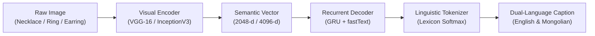

# 💎 Jewelry Vision

<div align="center">

### Fine-Grained Jewelry Identification & Multi-Lingual Caption Generation
*Deep Visual Feature Extraction (VGG-16 / InceptionV3) paired with Autoregressive GRU Decoder*

[](https://colab.research.google.com/github/whysari/jewelry-vision/blob/main/demo.ipynb)
[](https://www.python.org/)
[](https://tensorflow.org)
[](#-benchmarks)
[](LICENSE)

[**Try Live Demo**](https://colab.research.google.com/github/whysari/jewelry-vision/blob/main/demo.ipynb) • [**Architecture**](#-architecture--pipeline) • [**Benchmarks**](#-benchmarks) • [**Quickstart**](#-quickstart) • [**CLI Inference**](#-cli-inference)

</div>

---

## 🌟 Highlights

- **Hierarchical Classification**: 3-stage granularity hierarchy scaling from coarse categories to fine-grained metal, gemstone cut, and setting styles.
- **Top-Tier Performance**: Achieves **91.18% Correct Classification Rate (CCR)** on fine-grained jewelry descriptions.
- **Bi-Lingual Generation**: Native tokenization and autoregressive caption generation in both **English** and **Mongolian (Монгол хэл)**.
- **1-Click Cloud Execution**: Instant interactive testing via Google Colab with zero local installation or GPU requirements.
- **Dual Interface**: Modern interactive Gradio web application alongside an ultra-fast standalone CLI engine.

---

## 🔬 Architecture & Pipeline

Jewelry Vision utilizes an encoder-decoder architecture optimized for high-specular reflective surfaces and micro-scale geometry:



1. **Convolutional Visual Encoder**: Pre-trained **VGG-16** (4,096-dim) and **InceptionV3** (2,048-dim) backbones extract semantic visual features while remaining robust against specular reflections and background variance.
2. **Autoregressive Language Decoder**: A 256/512-unit **Gated Recurrent Unit (GRU)** network models natural language sequences with fastText word vectors.
3. **Multi-Lingual Vocabulary**: Tokenizes jewelry terminology across metals (gold, silver, platinum), gemstone cuts (solitaire, pavé, halo), and primary categories.

---

## 📊 Benchmarks

| Level | Model Architecture | Encoder Dim | Granularity | Accuracy / CCR | Key Evaluated Attributes |
|:---|:---|:---:|:---|:---:|:---|
| **Level 1** | VGG-16 + GRU | 4,096-d | Coarse Category | **~96.4%** | Necklaces (`зүүлт`), Earrings (`ээмэг`), Rings (`бөгж`), Bracelets (`бугуйвч`) |
| **Level 2** | InceptionV3 + GRU | 2,048-d | Material & Category | **~93.8%** | Yellow Gold, White Gold, and 925 Sterling Silver differentiation |
| **Level 3** | VGG-16 + GRU | 4,096-d | Complete Fine-Grained | **91.18%** | Comprehensive descriptions (metal purity, setting styles, gemstone cuts) |

---

## 🚀 Quickstart

### 1. ⚡ Run Free Live Demo in Google Colab (Zero Setup)
Click below to open the interactive notebook on Google's free cloud servers:

[](https://colab.research.google.com/github/whysari/jewelry-vision/blob/main/demo.ipynb)

In Colab, click **Runtime** → **Run all** (or `Ctrl+F9`). The interactive web demo will launch directly inside the notebook with a shareable public link.

---

### 2. 💻 Local Setup

```bash
# Clone the repository
git clone https://github.com/whysari/jewelry-vision.git
cd jewelry-vision

# Set up virtual environment
python -m venv venv
# On Windows:
venv\Scripts\activate
# On Linux/macOS:
source venv/bin/activate

# Install dependencies
pip install -r requirements.txt
```

#### Launch Interactive Web App
```bash
python app.py
```
Open **`http://localhost:7860`** to interact with the model and test sample images with 1 click.

---

## 💻 CLI Inference

Run predictions directly from your terminal:

```bash
# Level 3: Fine-grained multi-lingual captioning (91.18% CCR)
python infer.py --image samples/gold_necklace.jpg --level 3

# Level 1: Fast coarse category identification
python infer.py --image samples/diamond_earrings.jpg --level 1
```

---

## 📂 Repository Structure

```
jewelry-vision/
├── app.py                      # Interactive Gradio web application
├── demo.ipynb                  # 1-Click interactive Google Colab notebook
├── infer.py                    # Standalone CLI inference engine
├── requirements.txt            # Python dependencies
├── LICENSE                     # MIT License
├── README.md                   # Project documentation
├── models/                     # Pre-trained weights & tokenizers (91.18% CCR)
│   ├── Complete/               # Level 3: Fine-grained VGG-16 + GRU weights
│   ├── General_Accessories/    # Level 1: Category VGG-16 + GRU weights
│   └── Medium/                 # Level 2: InceptionV3 + GRU weights
├── input/                      # Token vocabulary and caption dictionaries
│   ├── captions.txt            # English lexicon
│   └── captions_mn.txt         # Mongolian lexicon
├── samples/                    # Test images (necklaces, earrings, bracelets)
└── src/                        # Core deep learning modules
    ├── modelFunctions.py       # CNN visual encoders & RNN decoders
    ├── dataFunctions.py        # Tokenizer, lexicon, and preprocessing
    ├── train.py                # Model training pipeline
    └── test.py                 # Evaluation & CCR calculation
```

---

## 📜 License & Author

- **Author**: Ragchaa Battsengel ([@whysari](https://github.com/whysari))
- **License**: Released under the [MIT License](LICENSE).
