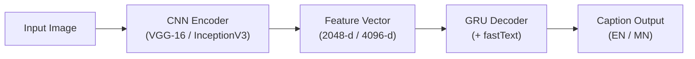

# Jewelry Vision

Jewelry classification and bilingual (English / Mongolian) caption generation using CNN encoders (VGG-16, InceptionV3) and a GRU decoder.

[](https://colab.research.google.com/github/whysari/jewelry-vision/blob/main/demo.ipynb)

---

## Overview

This project pairs pre-trained convolutional feature extractors with a recurrent language decoder to classify jewelry images and generate descriptive captions across three levels of detail:

1. **Visual Encoder:** Pre-trained **VGG-16** (4,096-d) and **InceptionV3** (2,048-d) feature extractors.
2. **Sequence Decoder:** A 256/512-unit **GRU** network trained with fastText embeddings.
3. **Bilingual Output:** Generates descriptions in English and Mongolian (`captions.txt` / `captions_mn.txt`) covering item category, metal type, and gemstone setting.



---

## Evaluation Results

| Level | Model | Feature Dim | Granularity | Accuracy (CCR) | Scope |
|:---|:---|:---:|:---|:---:|:---|
| **Level 1** | VGG-16 + GRU | 4,096 | Coarse category | 96.4% | Necklaces, earrings, rings, bracelets |
| **Level 2** | InceptionV3 + GRU | 2,048 | Material + category | 93.8% | Yellow gold, white gold, 925 silver |
| **Level 3** | VGG-16 + GRU | 4,096 | Full description | 91.18% | Metal purity, setting style, gemstone cut |

---

## Usage

### Google Colab

Open [`demo.ipynb`](https://colab.research.google.com/github/whysari/jewelry-vision/blob/main/demo.ipynb) in Google Colab and run all cells (`Runtime` → `Run all`) to launch the Gradio interface.

### Local Setup

```bash
git clone https://github.com/whysari/jewelry-vision.git
cd jewelry-vision

python -m venv venv
source venv/bin/activate  # On Windows: venv\Scripts\activate
pip install -r requirements.txt
```

Start the web UI (`http://localhost:7860`):

```bash
python app.py
```

Or run inference from the command line:

```bash
# Level 3: Full description
python infer.py --image samples/gold_necklace.jpg --level 3

# Level 1: Category only
python infer.py --image samples/diamond_earrings.jpg --level 1
```

---

## Project Layout

```text
jewelry-vision/
├── app.py                  # Gradio web interface
├── demo.ipynb              # Colab notebook
├── infer.py                # CLI inference script
├── models/                 # Pre-trained weights (Level 1, 2, 3)
├── input/                  # English and Mongolian vocabularies
├── samples/                # Sample test images
└── src/
    ├── modelFunctions.py   # Encoder and decoder definitions
    ├── dataFunctions.py    # Tokenization and preprocessing
    ├── train.py            # Training script
    └── test.py             # Evaluation script
```

---

## License

MIT — see [LICENSE](LICENSE).
